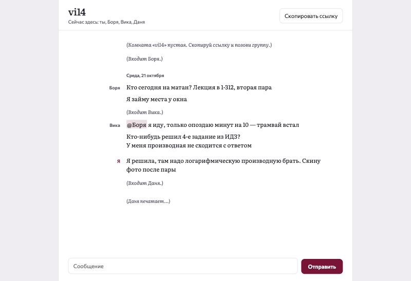

# Комната для группы

Чат в реальном времени для учебной группы: без регистрации, комната по ссылке.
Кидаешь в беседу `…/r/vi14`, и все пишут в одном месте.



Переписка свёрстана как текст пьесы. Имена стоят в узкой колонке слева, реплики справа,
а события комнаты записаны курсивом, как ремарки: *(Входит Вика.)*, *(Боря печатает…)*.

## Что умеет

- Комнаты по ссылке, история последних 100 сообщений, список тех, кто сейчас онлайн.
- «Печатает…» — не чаще раза в секунду на человека, сколько бы он ни печатал.
- Упоминания `@Боря` подсвечиваются.
- **Связь пропала — сообщения не теряются.** Неотправленное лежит в очереди и
  показывается бледным, пока сервер не подтвердит доставку. Клиент
  переподключается сам, с растущей задержкой и случайным разбросом, и после
  переподключения досылает очередь.
- **Без дублей.** Каждое сообщение несёт `clientId`, на сервере стоит
  уникальный индекс `(room, client_id)`. Если сообщение дошло, а подтверждение
  потерялось, повторная отправка его не задублирует.
- Ограничение частоты: не больше 12 сообщений за 10 секунд с одного соединения.
- Мёртвые соединения (закрыли ноутбук, пропал Wi-Fi) закрываются по ping/pong.

## Запуск

```bash
npm install
npm run build && npm start        # http://localhost:8080
```

Или в Docker, история сохраняется в volume:

```bash
docker build -t study-chat . && docker run -p 8080:8080 -v chat-data:/data study-chat
```

Для разработки: `npm start` в одном терминале и `npm run dev` в другом.
Vite проксирует `/ws` на Node-сервер.

## Как устроено

```
server/
  protocol.ts   типы событий для клиента и сервера + проверка входящих данных
  hub.ts        комнаты, присутствие, рассылка, «печатает», лимиты
  store.ts      история в SQLite (встроенный node:sqlite — ничего не компилируется)
  index.ts      HTTP: статика и /health, WebSocket на /ws, heartbeat
client/
  main.ts       подключение, очередь отправки, отрисовка «пьесы»
tests/          10 тестов: настоящий сервер на случайном порту и настоящие WebSocket-клиенты
```

Протокол — JSON-события с полем `t`:

| Клиент → сервер | Сервер → клиент |
|---|---|
| `join {room, name}` | `welcome {you, history, people}` |
| `say {text, clientId}` | `msg {msg}` — всем, включая отправителя: это и есть подтверждение |
| `typing` | `joined`, `left`, `typing {person}`, `error {text}` |

Сервер не доверяет ничему, что пришло по сокету. Каждое событие проходит
проверку типов, имя и комната нормализуются, длина ограничена. Текст хранится
и отдаётся как текст. Клиент вставляет его через `textContent` и узлы DOM,
а не через `innerHTML`, поэтому `` в сообщении — просто текст.
Для этого есть отдельный тест.

Если у человека открыты две вкладки, «(… уходит.)» появляется только когда
закрывается последняя.

## Стек

Node.js 24 (TypeScript запускается без сборки), `ws`, `node:sqlite`, Vite для
клиента, Vitest. Шрифты Literata и Commissioner.
